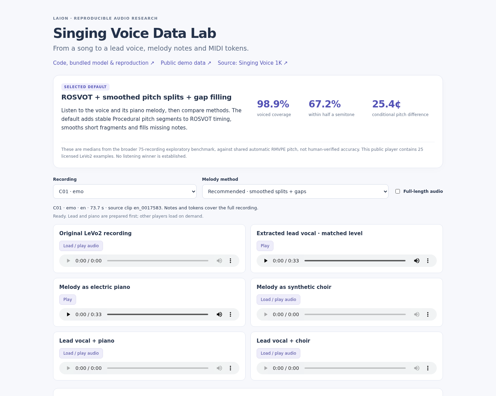

# Singing Voice Data Lab

**[Listen to the public demo](https://huggingface.co/spaces/laion/singing-voice-data-lab)** · [Public demo dataset](https://huggingface.co/datasets/laion/singing-voice-data-lab-demo) · [Pipeline and model details](docs/PIPELINE.md)

Turn a song into an isolated lead voice, a sequence of melody notes, standard MIDI, and reversible MIDI tokens. This repository contains the processing code, the frozen ROSVOT + Procedural combination rules, alternative pipelines, and a compact, bundled lead-vocal separation checkpoint. The public player lets you compare the original recording, extracted voice, piano/choir reconstructions and vocal overlays.

```text
Song → Mega53 lead-vocal extraction → ROSVOT notes + RMVPE pitch
     → stable pitch segments + short-fragment smoothing + gap filling
     → note JSON + MIDI + complete flattened MIDI tokens
```

The default is **`rosvot_procedural_segmented`**: the strongest tested ROSVOT-based combination for joint pitch agreement and coverage in our exploratory benchmark. It is an engineering default, not a claim of verified musical correctness. The original ROSVOT and Procedural predictions and three other fusion recipes remain available.

## Packed synthetic singing corpus

The [public synthetic singing dataset](https://huggingface.co/datasets/laion/synthetic-singing-voice)
adds the default ROSVOT + Procedural note dictionary, standard MIDI and complete
flattened MIDI to the original synthetic vocals and MOSS-v2 codes. The
[packed-data guide](docs/PACKED_DATASETS.md) explains the GENERAL / MIDI Annotation /
SCRIPT format, archive processing and reproduction. Check the dataset card for
actual upload progress. The
[experimental singing checkpoint](https://huggingface.co/laion/Humaneness-Voice-Large-1.7-Singing-Experimental)
is a proof of concept for learning singing alongside TTS; it predates the new
MIDI conditioning field.

## Quick start

Use a Linux CUDA machine for the neural stages, Python 3.10 or newer, and FFmpeg on `PATH`. Install matching CUDA-enabled PyTorch and Torchaudio builds for your machine; the recorded benchmark used PyTorch 2.9.1 / CUDA 12.8. The post-processing and public-demo reproduction also work on CPU.

```bash
git clone https://github.com/LAION-AI/singing-voice-data-lab.git
cd singing-voice-data-lab
python -m venv .venv
source .venv/bin/activate
pip install -e '.[inference,render]'

# The lead separator and SoundFont are already included.
# Fetch the exact external ROSVOT/RWBD and RMVPE checkpoints once.
python lab.py download-models

# One audio file, or a folder of audio files. Default: smoothed ensemble.
python lab.py run song.wav --output runs/example --render
```

This is a clone-based application: use the editable installation above so the bundled code and model files stay beside `lab.py`. No Slurm installation, private filesystem layout or inference API key is required. If you use a shared cluster, submit neural stages through its normal GPU scheduler.

Each recording produces:

```text
runs/example/benchmark/song_00001/
  lead_vocal.flac           # complete extracted stereo lead
  pitch/f0.npz             # complete automatic continuous pitch and times
  note_events/             # original ROSVOT, Procedural and four ensembles
  annotation.json          # selected/default complete note events
  melody.mid               # selected/default standard MIDI
  melody.tokens.txt        # selected/default complete 10-ms MIDI tokens
  listening_v2/            # matched-level full and preview MP3s with --render
```

Use `--already-lead` to skip separation for an input you already consider isolated. Generated vocal audio can still contain accompaniment, so this is a user decision. `--separator-batch-size 1` reproduces the benchmark window processing; larger values batch separator windows for throughput and can change floating-point results slightly. Intermediate outputs and stage status JSON are preserved. A fresh `run` never overwrites an existing manifest; resume a specific worker with the stage command described in [the pipeline guide](docs/PIPELINE.md).

## Reproduce the public results without a GPU

The public dataset contains 25 LeVo2 recordings from LAION Singing Voice 1K, their separated lead, frozen baseline notes/pitch and listening derivatives. Reapply all four fusion rules and check every complete token sequence and binary MIDI file:

```bash
pip install -e .
python tools/reproduce_demo.py --output runs/reproduced-demo
```

The tool downloads a checksum-pinned public TAR when needed. For an existing download, pass `--data /path/to/benchmark`. It runs no neural inference and makes no paid API calls. The repository's publication checks also reproduce all four ensembles on the original 75-recording benchmark. Access-controlled source recordings from that broader benchmark are not bundled here.

## Results and limits

These are **medians over 75 recordings**, measured against automatic RMVPE pitch. Higher coverage and within-50-cents agreement are better; lower conditional pitch difference is better. One semitone is 100 cents.

| Method | Voiced coverage ↑ | Within 50 cents / all reference-voiced time ↑ | Conditional pitch difference ↓ |
|---|---:|---:|---:|
| ROSVOT | 97.8% | 62.2% | 28.48 cents |
| Procedural | 89.2% | 68.8% | 21.07 cents |
| Conservative pitch voting | 97.8% | 62.5% | 28.50 cents |
| ROSVOT + gap filling | 98.9% | 62.6% | 28.45 cents |
| Pitch voting + gap filling | 98.9% | 63.7% | 27.81 cents |
| **Smoothed pitch splits + gap filling — default** | **98.9%** | **67.2%** | **25.40 cents** |

The default keeps each ROSVOT parent note's outer boundaries, uses stable Procedural pitch runs of at least 90 ms to split it internally, absorbs fragments shorter than 50 ms into a neighbouring pitch, and adds Procedural fragments of at least 90 ms in uncovered gaps. This produces more note boundaries: 27,755 versus ROSVOT's 22,399 across the benchmark. Listen for unwanted fragmentation.

Coverage counts wrong notes too. The within-50 measure penalizes missing and ambiguous notes. Conditional pitch difference excludes missing and overlapping material, so it must be read together with coverage. ROSVOT and the Procedural baseline share RMVPE; Procedural is derived directly from the scoring reference. Their agreement is therefore biased and does not establish human-verified transcription accuracy. Procedural alone remains stronger on the benchmark's Frame F1 proxy but covers less singing time. No universal quality winner or ensemble listening score is claimed.

We explored 69 predefined combinations. Fifteen recordings selected the vote/split settings; the remaining 60 were reported separately. The recordings had already been examined, so this is an internal exploratory split, not untouched external validation. [Detailed rules and interpretation](docs/ENSEMBLES.md) explain the alternatives and the extra-activity/fragmentation checks. The default does not replace the continuous F0 with quantized notes: both are saved.

## Bundled separator

The recorded separator is **MVSEP Mega 53 BS-RoFormer v1** by Roman Solovyev / MVSep. The bundled version retains the original shared backbone and only its lead-vocal mask head (original index 27, remapped to head 0). Unused output heads are removed. No tensor is quantized or retrained. It occupies about **77.5 MB**, rather than the original 1.37-GB 53-head checkpoint, and is stored in three Safetensors shards below GitHub's individual-file limit.

See [the bundled model](models/mega53_lead_v1/manifest.json), [its licence](models/mega53_lead_v1/LICENSE), and [the reproducible pruning tool](tools/prepare_lead_checkpoint.py). Every retained tensor's value/dtype was checked against the pinned official checkpoint, and the pruned model loaded strictly. The author explicitly confirmed MIT licensing for the 53-stem weights [here](https://github.com/ZFTurbo/Music-Source-Separation-Training/issues/245#issuecomment-5834608838).

Extraction uses stereo 44.1-kHz audio, 20-second windows, 50% overlap and normalized Hann overlap-add. It computes only the lead head. Separation can retain backing singers or remove quiet consonants; an extracted stem is not certified monophonic. See [model provenance and dependencies](models/README.md).

## Other pipelines and annotations

The `code/` directory includes the recorded GAME, ROSVOT, STARS, MuScriptor Large/Medium, ASR and captioning wrappers as advanced comparison tools. Original upstream implementations/licences are vendored or pinned. Larger/gated model weights are fetched separately and keep their own licences; MuScriptor weights are CC BY-NC 4.0 and are not bundled. English/Chinese transcript conditioning and ASR alignment are not assumed to be verified lyrics. [Advanced setup](docs/ADVANCED.md) documents these optional stages and their separate environments.

## Example source datasets

- **[LAION Singing Voice 1K](https://huggingface.co/datasets/laion/singing-voice-1k):** LeVo2-generated singing-vocal recordings, CC BY 4.0. This is the source of the public demo.
- **[LAION-Tunes](https://huggingface.co/datasets/laion/laion-tunes):** music metadata and prompts, with gated access and CC BY-NC 4.0 metadata terms. Obtain any corresponding audio through an authorized source; a metadata licence does not automatically license the recordings.
- **[Public demo dataset](https://huggingface.co/datasets/laion/singing-voice-data-lab-demo):** the 25 licensed source examples and derived annotations/listening files used in the public player, with attribution and recorded changes.

The application and our processing code are MIT. Third-party copyright notices, model terms and the GeneralUser GS SoundFont licence remain separate; see [THIRD_PARTY_NOTICES.md](THIRD_PARTY_NOTICES.md). No source music, API token, personal filesystem path, private inventory or unrelated project material is included in the GitHub repository.

## Run or host the player

The public Hugging Face player is a static site: `demo/static/`. It requests only the required byte ranges of the checksum-pinned, uncompressed public TAR and verifies each member's SHA-256. Audio is loaded on demand, so no model server or org compute subscription is needed. To preview locally, run `python -m http.server 8000 --directory demo/static` and open the localhost URL. `demo/app.py` is also provided as an optional Gradio frontend for your own runtime.

`tools/build_static_demo.py` rebuilds the static metadata/index from an unpacked public dataset, its pinned TAR and `demo/dataset_config.json`. The small `demo/static/clips/*.json` files and manifest contain derived CC BY 4.0 public-demo annotations; their data terms are separate from the MIT JavaScript/application code.

## Validation

```bash
python -m unittest discover -s tests -v
```

The checks cover bundled shard hashes, complete token timelines, colliding 10-ms onsets, CLI availability, and stereo overlap-add with a short tail and different window batch sizes. The DSP test uses an identity predictor, not new neural inference. Publication evidence in `evidence/` records exact note/token/MIDI reproduction for all four ensembles on 75 recordings and exact public-demo reproduction on 25. Tensor equality and strict loading validate the compact checkpoint derivation; a fresh end-to-end GPU inference run on this portable checkout has not been performed.

[](https://huggingface.co/spaces/laion/singing-voice-data-lab)
